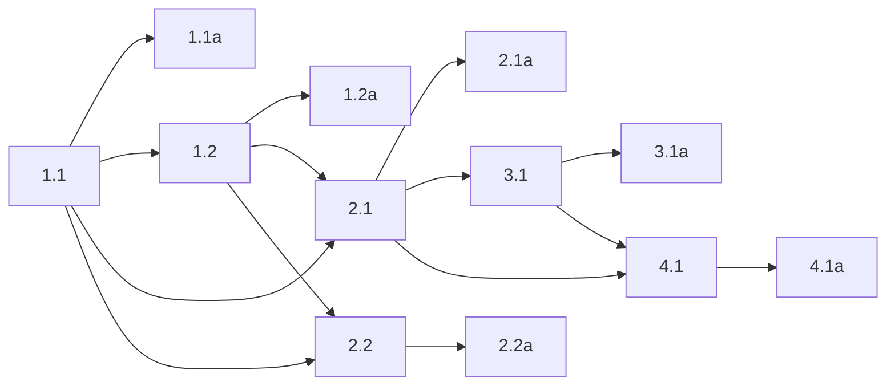

## 1. Shared tab stabilization lifecycle
- [ ] 1.1 Extract the background-owned tab stabilization lifecycle into reusable code in the extension layer that currently owns command execution and tab state checks (start by inspecting `packages/extension/src/commands/navigation.ts`, `packages/extension/src/commands/interaction.ts`, and `packages/extension/src/session/session-manager.ts`). The shared code should: resolve the leased tab, inspect tab state before dispatch, fail fast when the pre-action tab is already loading, inspect tab state again after dispatch, decide whether a wait is required, and expose a clear success/failure result to the caller.
- [ ] 1.1a Validate the lifecycle decision logic with targeted extension tests near the command/session tests. Cover at minimum: (a) stable before + stable after => no wait, (b) stable before + loading after => wait required, and (c) loading before => fail fast before dispatch. Evidence should show which branch executed and that the result matches the strict failure semantics.
- [ ] 1.2 Add a single-use, tab-scoped, main-frame load waiter in the extension background layer and update `packages/extension/wxt.config.ts` to request the Firefox `webNavigation` permission. The waiter should be armed before dispatch, listen only for the leased tab's top-level navigation completion/error events, reject on timeout/error, and always clean up listeners in `finally`.
- [ ] 1.2a Validate the waiter with targeted extension tests that prove: completion resolves, navigation error rejects, timeout rejects, cleanup runs after both success and failure, and non-matching tab/subframe events do not satisfy the waiter. Include a manifest assertion that `webNavigation` is declared.

## 2. Extension command integration
- [ ] 2.1 Route `click`, `type`, `hover`, `drag`, `press_key`, and `select_option` through the shared lifecycle instead of directly dispatching and returning from `packages/extension/src/commands/interaction.ts`. Done means these commands no longer own ad hoc stabilization behavior themselves and they all follow the same pre-check -> dispatch -> post-check -> optional wait contract.
- [ ] 2.1a Validate input-command integration with targeted extension tests for both categories of behavior: non-navigating actions that should snapshot/read back immediately after dispatch, and navigation-triggering actions that should wait before readback. Evidence should show the action is dispatched exactly once and that readback is delayed only for the loading case.
- [ ] 2.2 Reuse the extracted lifecycle for explicit navigation commands and remove duplicated `waitForTabLoad` ownership currently split between `packages/extension/src/commands/navigation.ts` and `packages/extension/src/session/session-manager.ts`. Done means there is one clear owner for load waiting policy and both explicit navigation commands and lease setup reuse it instead of maintaining separate copies.
- [ ] 2.2a Validate explicit navigation behavior with the existing navigation command tests plus regression coverage for the shared lifecycle path used during lease creation/session setup. Evidence should show no behavior change to successful `navigate`, `go_back`, and `go_forward` flows other than using the shared implementation.

## 3. MCP post-action readback
- [ ] 3.1 Remove ad hoc immediate post-action readback from MCP interaction tool wrappers (start with `packages/mcp/src/tools/common.ts` and `packages/mcp/src/utils/aria-snapshot.ts`) and make them consume lifecycle-managed post-action state while preserving the current action-summary-plus-snapshot response shape. Done means MCP clients still see the same response format, but the MCP layer is no longer independently racing `getUrl`, `getTitle`, and `snapshot` right after dispatch.
- [ ] 3.1a Validate the MCP tool layer with targeted tests for interaction tool responses and one smoke-level command that exercises an interaction end-to-end through the socket boundary. Evidence should show: response text shape is unchanged, successful interaction still returns URL/title/snapshot, and a post-action readback failure now surfaces as a command failure rather than a partial success.

## 4. Truthful workflow logging
- [ ] 4.1 Add phase-aware workflow logging across the extension and hub paths that already emit command logs (inspect current logging in the extension command handler/background entrypoint and the hub request pipeline first). Each user command should have one parent identifier, internal wait/readback phases should be marked as `origin=system`, and failure logs should name the failed phase (`precondition`, `dispatch`, `wait`, or `readback`). Keep extension logging console-based; do not introduce a new logging framework.
- [ ] 4.1a (HUMAN_REQUIRED) Reproduce a navigation-triggering interaction in a real browser session and confirm the logs show the full story in order: user command begin, post-action loading detection, wait phase, readback phase, and final success/failure. Capture enough log output to prove the action itself is not falsely reported as failed when a later phase fails.

